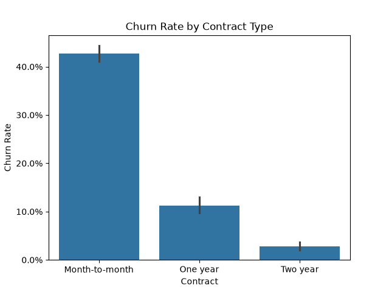
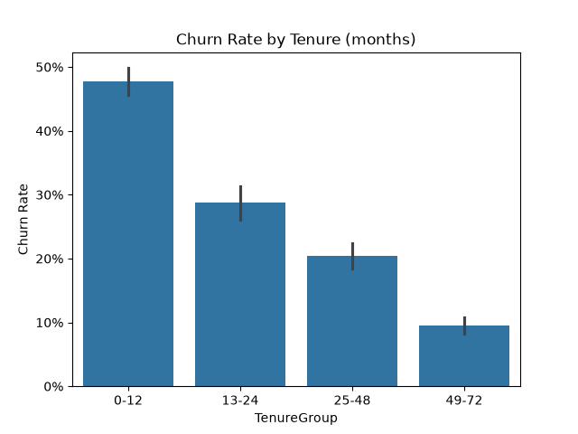
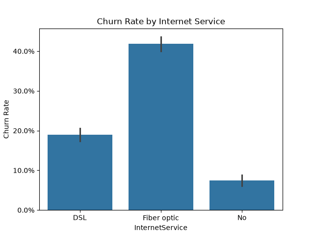
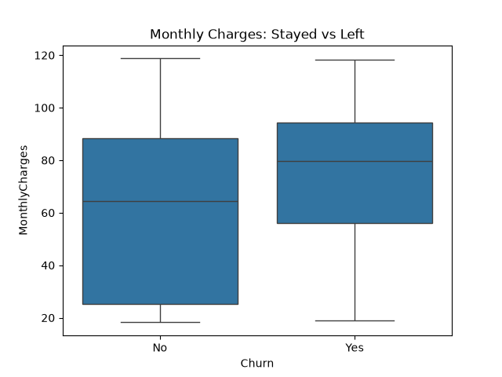
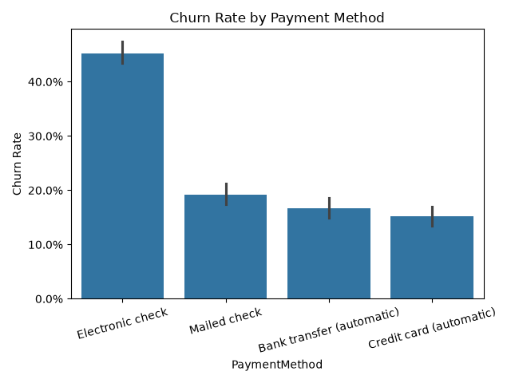

# 📊 Telco Customer Churn Analysis Using Python

## 📌 Project Overview

This project explores customer churn in the telecommunications industry using Python. The analysis focuses on identifying customer groups with higher churn rates and understanding the patterns associated with customers leaving the company.

The goal is to turn raw customer data into meaningful insights that can help businesses understand customer behaviour and improve retention strategies.

## 🎯 Project Objectives

* Analyse customer churn patterns.
* Identify customer groups with higher churn rates.
* Explore the relationship between customer characteristics and churn.
* Visualise key findings using charts.
* Provide data-driven business recommendations.

## 📂 Dataset

**IBM Telco Customer Churn Dataset**

* Source: Kaggle
* Original records: 7,043 customers
* Original columns: 21
* Final records after cleaning: 7,032 customers

The dataset contains customer demographics, account information, subscribed services, payment methods and churn status.

## 🛠️ Tools & Technologies

* **Python** – Data analysis
* **Pandas** – Data manipulation and cleaning
* **Matplotlib** – Data visualisation
* **Seaborn** – Statistical visualisation

## 🧹 Data Cleaning

The following cleaning steps were performed:

1. Loaded the dataset using Pandas.
2. Converted `TotalCharges` from text to numeric format.
3. Identified 11 missing values in `TotalCharges`.
4. Confirmed that the missing values belonged to customers with zero months of tenure.
5. Removed those 11 incomplete records.
6. Created a numerical `ChurnValue` column to support churn-rate calculations.
7. Created customer tenure groups for further analysis.

**Final dataset:** 7,032 customers and 21 original columns, plus two additional analysis columns.

## 📈 Key Findings

1. The overall customer churn rate was **26.6%**.
2. Month-to-month contract customers had the highest churn rate at **42.7%**, compared with 11.3% for one-year contracts and 2.8% for two-year contracts.
3. Customers in their first 12 months had a churn rate of **47.7%**, while customers with more than four years of tenure had a rate of 9.5%.
4. Fiber optic customers had a churn rate of **41.9%**, compared with 19.0% for DSL customers.
5. Electronic check users had the highest payment-method churn rate at **45.3%**.
6. Customers who left had higher average monthly charges (74.44) than customers who stayed (61.31).
7. Senior citizens had a churn rate of **41.7%**, compared with 23.7% for non-senior customers.
8. Customers without online security or technical support had churn rates of approximately 41–42%, compared with approximately 15% among customers with these services.
9. Gender showed very little difference in churn rates: 27.0% for females and 26.2% for males.

*Note: These findings represent associations in the dataset and do not establish cause-and-effect relationships.*

## 💡 Business Recommendations

Based on the analysis, the following recommendations could help improve customer retention:

* **Contract Strategy:** Encourage month-to-month customers to consider longer-term contracts through discounts and loyalty benefits.
* **Customer Onboarding:** Improve onboarding and customer support during the first 12 months.
* **Service Improvements:** Consider offering online security and technical support through free trials or bundled packages.
* **Payment Strategy:** Encourage automatic payment methods through suitable incentives.
* **Customer Retention:** Investigate the needs of senior customers and customers with higher monthly charges.

## 📊 Data Visualizations

### 1. Churn Rate by Contract Type



### 2. Churn Rate by Tenure Group



### 3. Churn Rate by Internet Service



### 4. Monthly Charges: Stayed vs Left



### 5. Churn Rate by Payment Method



## 📁 Project Structure

```text
Customer-Churn-Analysis/
│
├── README.md
├── customer_churn.py
├── WA_Fn-UseC_-Telco-Customer-Churn.csv
│
├── churn_by_contract.png
├── churn_by_tenure.png
├── churn_by_internet.png
├── charges_by_churn.png
└── churn_by_payment.png
```

## 📝 Conclusion

This analysis highlights several customer characteristics associated with higher churn rates. Contract type, customer tenure, internet service, payment method and additional services showed notable differences in churn behaviour.

The project demonstrates how Python libraries can be used for data cleaning, exploratory data analysis, visualisation and business insight generation.

**Project Type:** Data Analysis (No Machine Learning)

---

**Created as a Data Analytics Portfolio Project.**
